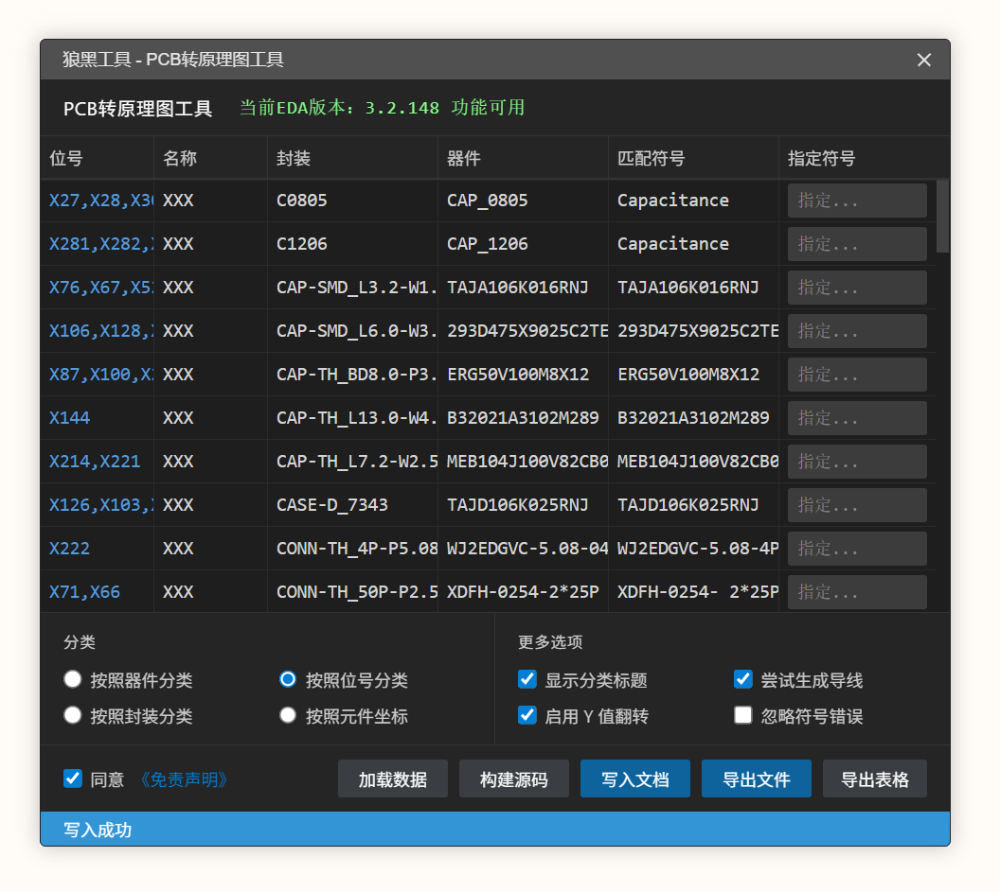

# 狼黑工具：PCB 转原理图专业版使用文档

本项目是一款针对嘉立创EDA（专业版）开发的扩展工具，旨在实现从 PCB 设计文件逆向生成原理图的功能。工具支持千量级元件的高效处理，能够解析多部件符号并自动生成基于网络的物理导线。

## 1. 运行环境与版本兼容性

### 1.1 支持版本
- 嘉立创EDA专业版 V2.2.x 系列
- 嘉立创EDA专业版 V3.x 系列

### 1.2 运行要求
- PCB 中的每个元件必须具备唯一的 Unique ID（唯一标识符）。
- 若需要使用“从 PCB 创建导线”功能，必须将对应的 PCB 文件与目标原理图文件置于同一个编辑器窗口中（禁止分屏或跨窗口运行）。

## 2. 核心操作流程

### 第一步：初始化与数据加载
1. 在嘉立创EDA中打开目标工程的原理图页。
2. 通过插件菜单启动“PCB 转原理图工具”。
3. 阅读并同意《免责声明》。
4. 点击“加载数据”按钮。系统将自动解析当前工程的 .epro 文件，提取 PCB 元件的封装、器件及网络信息。

### 第二步：符号匹配与校验
在界面中心的表格中，您可以查看元件的匹配状态：
1. **自动匹配**：若元件已完成器件标准化，系统会自动填充“匹配符号”列。
2. **指定符号**：若某元件缺失符号信息（行显示为红色），您需要在“指定符号”列手动输入符号名称（例如：匹配符号里的任意名称）。
3. **表格导出**：建议在大规模转换前使用“导出表格”功能，备份当前的匹配映射关系。

### 第三步：配置转换参数
在底部面板中根据需求配置以下选项：
- **分类方式**：
    - 按照器件分类：相同型号的器件将排列在一起。
    - 按照位号分类：按位号首字母（R, C, U等）及数字顺序排列。
    - 按照封装分类：相同封装规格的元件归为一类。
    - 按照元件坐标：尝试 1:1 还原元件在 PCB 上的物理相对位置。
- **更多选项**：
    - 显示分类标题：在原理图中为每一组元件添加文字标题。
    - 尝试生成导线：根据 PCB 焊盘的网络连接自动绘制原理图导线。
    - 启用 Y 值翻转：针对 V3 版本环境，若发现坐标系不一致请勾选此项。
    - 忽略符号错误：勾选后将跳过缺失符号的元件，仅转换已匹配的部分。

### 第四步：构建与应用
1. 点击“构建源码”：系统将在后台生成符合 EDA 协议的原理图数据流。
2. **写入方式选择**：
    - **写入文档**：直接将生成的图元渲染到当前画布。注意，在 V3 版本中建议先手动清空画布再执行写入。
    - **导出文件**：生成一个新的 .epro 工程文件包，用户可通过“文件 -> 打开 -> 嘉立创EDA”手动导入，此方式可有效规避大型工程的内存限制问题。

### 第五步：后期同步
完成原理图生成后，请在原理图界面使用 EDA 原生的“从 PCB 导入变更”功能。这一步能够补全所有元件的位号、名称及自定义参数，确保原理图与 PCB 的完全同步。

## 3. 已知问题与解决方案

### 3.1 客户端白屏/内存溢出 (OOM)
当工程元件数量极多（通常超过 500 个）且启用了导线生成时，一次性写入大量源码可能导致客户端触发 V8 Javascript OOM 错误。
- **解决方案**：使用“导出文件”功能生成独立工程，或尝试在网页版 EDA 中运行插件（网页版具备更好的内存管理机制）。

### 3.2 V3 版本画布残留
由于 V3 版本底层渲染机制差异，直接写入可能会导致图元堆叠。
- **解决方案**：在点击“写入文档”前，请确保当前原理图页为空白。

## 4. 技术进阶说明

本工具核心逻辑依赖于对工程文件（.epro）的解压与 project.json 的解析。理论上，只要提供合法的 .epro 文件，该工具的 TypeScript 核心模块（src/core）可以脱离 EDA 软件独立运行，为自动化文档恢复提供了可能性。

## 5. 许可证
本扩展插件采用 Apache License 2.0 协议授权。